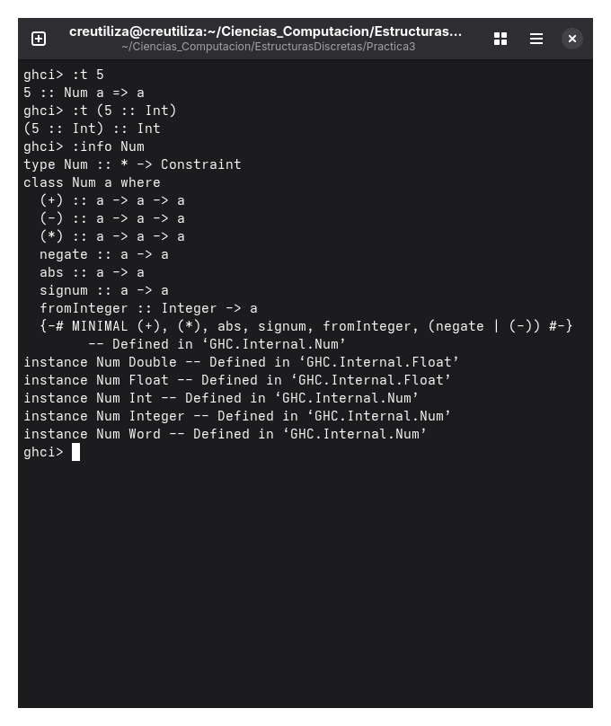

# Practica 3

## Objetivo
Familiarizarnos con las clases de tipo en haskell como : Eq, Ord, Show, Enum

## 1. ¿Cual es la diferencia entre Num e Int

Para empezar Num es un tipo de clase que agrupa a los tipos de dato a los cuales se les pueden hacer las operaciones como la suma, resta, multiplicacion, valor absoluto, tales como son los tipos de dato: Int, Integer, Float, Double, Word, Integral, Fractional.

Por otro lado Int es un tipo de dato de clase Num, es decir se le pueden hacer todas las operaciones que se les hace a los que son de clase Num.

Ademas Num en una funcion puede ser cualquier tipo de dato que sea de esa clase, mientras que al poner Int, solo abarca los enteros y nada mas.

## La chivita Recursiva
La recursion viene siendo un patron o ciclo que se va repetiendo con el objetivo de resolver un problema,tambien se puede ver como que se llama asi misma y se sigue repitiendo hasta que finalmente se llega a la solucion, sirve bastante pues en ves de resolver un problema grande, primero lo divide en partes mas sencillas.

### Referencias
- GHC Team. (s.f.). GHC.Num [Documentación de la librería base-4.22.0.0]. Hackage. Recuperado de https://hackage-content.haskell.org/package/base-4.22.0.0/docs/GHC-Num.html#v:abs
